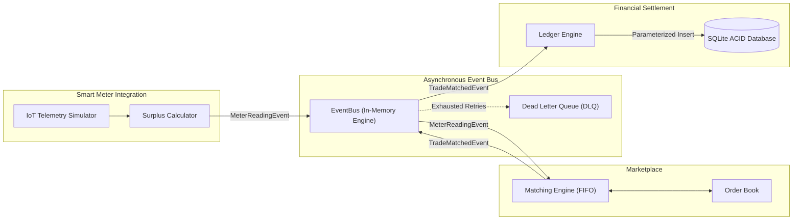

# EcoGrid Energy
## ICT711 Assessment 2 Proof of Concept: Peer-to-Peer Renewable Energy Trading Platform

[](.github/workflows/ci.yml)
[](https://www.python.org/)
[](LICENSE)

---

## 1. Project Purpose & Assessment Scenario

**EcoGrid Energy** is a software architecture proof-of-concept (PoC) developed for **ICT711 Assessment 2**. 

The system models a decentralized, peer-to-peer (P2P) renewable energy trading platform designed for residential neighborhoods. Homeowners equipped with rooftop solar photovoltaic (PV) systems ("prosumers") can automatically sell surplus electricity to local neighbors.

### Core Architectural Challenge
The platform must ingest continuous, high-frequency IoT smart meter telemetry from hundreds of households without blocking commercial trade matching or risking financial transaction inconsistencies.

To solve this, the system demonstrates an **Asynchronous Event-Driven Architecture (EDA)** built around **Domain-Driven Design (DDD)** bounded contexts.

---

## 2. Bounded Contexts

The architecture partitions the domain into three strictly separated bounded contexts and a shared technical kernel:



1. **Smart Meter Integration (`smart_meter`):** Ingests solar generation and household load telemetry; calculates net solar surplus (`surplus_kwh = max(generation - consumption, 0.0)`); publishes `MeterReadingEvent`.
2. **Marketplace (`marketplace`):** Manages buyer bids and seller supply offers; executes price-compatible FIFO matching; strictly prevents energy overselling; publishes `TradeMatchedEvent`.
3. **Financial Settlement (`settlement`):** Consumes matched trades; enforces database-level idempotency; calculates monetary totals; persists immutable financial transaction records to SQLite (`data/ecogrid.db`).
4. **Shared Kernel (`shared`):** Contains immutable domain event dataclasses, centralized configuration, structured logging with correlation IDs, and the asynchronous `EventBus` with retry/DLQ mechanisms.

---

## 3. Project Directory Structure

```text
EcoGrid-Energy/
│
├── .github/
│   └── workflows/
│       └── ci.yml                     # Multi-version Python CI/CD pipeline
│
├── data/
│   └── ecogrid.db                     # SQLite database (auto-created at runtime)
│
├── docs/
│   ├── adr/                           # Architectural Decision Records
│   │   ├── ADR-001-event-driven-architecture.md
│   │   ├── ADR-002-bounded-context-separation.md
│   │   ├── ADR-003-eventual-consistency.md
│   │   └── ADR-004-sqlite-for-poc.md
│   ├── ai-evidence-guide.md           # Controlled AI usage guide & tracking table
│   ├── architecture.md                # Full architecture specification & diagrams
│   ├── assessment-traceability.md     # Traceability matrix mapping requirements
│   ├── collaboration-evidence-checklist.md  # Screenshot guide for GitHub/Monday/Teams
│   ├── context-map.md                 # Strategic DDD context map & language tables
│   ├── fitness-functions.md           # Documentation of 5 architectural fitness tests
│   ├── resilience.md                  # Fault tolerance, retries, DLQ & FMEA matrix
│   └── tradeoffs.md                   # Monolith vs Microservices vs EDA comparison
│
├── marketplace/
│   ├── __init__.py
│   └── service.py                     # Order books, FIFO matching, trade publishing
│
├── scripts/
│   ├── failure_demo.py                # Resilience, retry, DLQ & idempotency demo
│   └── performance_demo.py            # High-volume (1,500+ event) throughput benchmark
│
├── settlement/
│   ├── __init__.py
│   └── service.py                     # SQLite persistence, ACID transactions, idempotency
│
├── shared/
│   ├── __init__.py
│   ├── config.py                      # Strongly typed environment configuration
│   ├── event_bus.py                   # Async EventBus, retry handler, DeadLetterQueue
│   ├── logging_config.py              # Structured logging formatter & correlation IDs
│   └── models.py                      # Immutable frozen domain event dataclasses
│
├── smart_meter/
│   ├── __init__.py
│   └── simulator.py                   # High-frequency IoT smart meter simulation engine
│
├── tests/
│   ├── __init__.py
│   ├── test_fitness_functions.py      # Executable fitness tests (FAST, SECURE, etc.)
│   └── test_system.py                 # 12 core unit, integration & isolation tests
│
├── .env.example                       # Environment configuration template
├── .gitignore                         # Exclusions for virtualenvs, databases, caches
├── main.py                            # End-to-end demonstration orchestrator
├── README.md                          # Main project guide
└── requirements.txt                   # Standard-library runtime dependency manifest
```

---

## 4. Quickstart & Installation

### Prerequisites
- Python 3.10, 3.11, 3.12, 3.13, or 3.14.
- Git.

### Setup Instructions

1. **Clone or Navigate to the Repository:**
   ```bash
   cd EcoGrid-Energy
   ```

2. **Create and Activate a Virtual Environment:**
   - **Windows (PowerShell):**
     ```powershell
     python -m venv .venv
     .venv\Scripts\Activate.ps1
     ```
   - **macOS / Linux:**
     ```bash
     python3 -m venv .venv
     source .venv/bin/activate
     ```

3. **Install Dependencies:**
   ```bash
   pip install -r requirements.txt
   ```
   *(Note: The core PoC uses Python's standard library modules `asyncio`, `sqlite3`, `dataclasses`, `unittest`, and `logging`; no heavy third-party packages are required).*

---

## 5. Execution Guide

### A. Run Main End-to-End Demonstration
Simulates 20 households emitting 1,000 smart meter readings, matches P2P trades against queued buyer bids, persists settlements to SQLite, and prints the operational dashboard:
```bash
python main.py
```

### B. Run Automated Test Suite & Fitness Functions
Executes all 18 automated tests (12 functional test suites + 6 architectural fitness function tests):
```bash
python -m unittest discover -s tests -v
```

### C. Run High-Volume Performance Benchmark
Simulates high-frequency ingestion (1,500+ IoT meter events), measuring execution time, throughput (events/sec), and mean latency:
```bash
python scripts/performance_demo.py
```

### D. Run Resilience & Fault-Tolerance Demonstration
Executes controlled failure scenarios showcasing:
1. Transient subscriber socket timeout $\rightarrow$ Automatic retry (3 attempts) $\rightarrow$ Successful recovery.
2. Persistent downstream crash $\rightarrow$ Retries exhausted $\rightarrow$ Safe containment in Dead Letter Queue (DLQ).
3. Network replay of duplicate trade $\rightarrow$ Database idempotency prevents duplicate billing.
```bash
python scripts/failure_demo.py
```

---

## 6. Architectural Fitness Functions

In alignment with ICT711 Assessment 2, automated fitness functions are implemented in `tests/test_fitness_functions.py` to evaluate the system against core quality attributes:

| Quality Attribute | Fitness Function Check | Measured Threshold | Status |
| :--- | :--- | :--- | :---: |
| **Performance (FAST)** | Ingestion & matching of 200 high-frequency events | $< 2.0\text{s}$ duration ($> 100\text{ events/sec}$) | **PASSED** |
| **Security (SECURE)** | Rejection of negative pricing, negative generation, bad schemas | `ValueError` raised at domain perimeter | **PASSED** |
| **Maintainability (MAINTAINABLE)** | Modularity inspection: `smart_meter` & `marketplace` isolated from DB | Zero imports of `sqlite3` or `settlement` | **PASSED** |
| **Evolvability (EVOLVABLE)** | Attaching a new dynamic subscriber (`GridCarbonAuditor`) | Registered with zero publisher code modification | **PASSED** |
| **Resilience (RESILIENT)** | Fault isolation & Dead Letter Queue (DLQ) quarantine | Failing handler isolated without crashing bus | **PASSED** |

---

## 7. Key Architectural Decisions (ADR Summaries)

- [ADR-001: Event-Driven Architecture](docs/adr/ADR-001-event-driven-architecture.md) — Adopts asynchronous event choreography to decouple high-frequency IoT smart meter telemetry from financial database persistence.
- [ADR-002: Bounded Context Separation](docs/adr/ADR-002-bounded-context-separation.md) — Enforces strict Domain-Driven Design boundaries between `smart_meter`, `marketplace`, and `settlement`.
- [ADR-003: Eventual Consistency](docs/adr/ADR-003-eventual-consistency.md) — Replaces synchronous 2PC distributed transactions with an eventual consistency model backed by idempotency keys and compensating transaction readiness.
- [ADR-004: SQLite for Proof-of-Concept](docs/adr/ADR-004-sqlite-for-poc.md) — Leverages standard library parameterized SQLite for zero-dependency local verification and testing.

---

## 8. Limitations & Production Roadmap

This software is an educational **proof-of-concept** designed for academic evaluation. In a production enterprise deployment, the following evolutionary upgrades would be implemented:

1. **Distributed Message Broker:** Replace the in-process `EventBus` with Apache Kafka, AWS Kinesis, or Azure Service Bus to support multi-node event streaming and persistent consumer offset tracking.
2. **IoT Gateway & Security:** Ingest real meter telemetry over MQTT via AWS IoT Core with mutual TLS (mTLS) certificate authentication per physical meter.
3. **Containerized Microservices:** Package each bounded context into independent Docker containers orchestratable via Kubernetes (EKS/GKE).
4. **Clustered Database:** Migrate the SQLite settlement ledger to a distributed PostgreSQL cluster (e.g. AWS Aurora PostgreSQL) with double-entry ledger bookkeeping.
5. **Observability Stack:** Export structured log correlation IDs to OpenTelemetry, Prometheus, and Grafana for distributed trace visualization.
