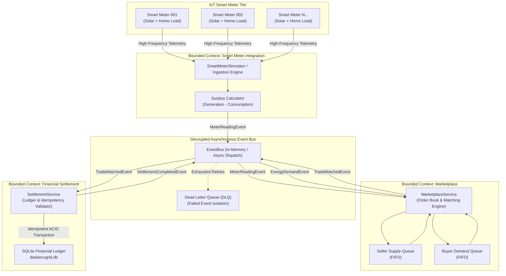
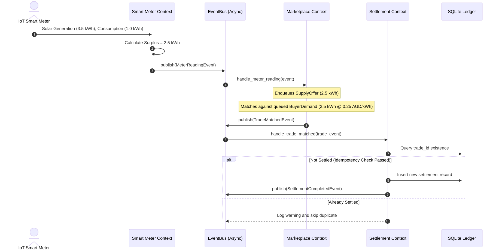
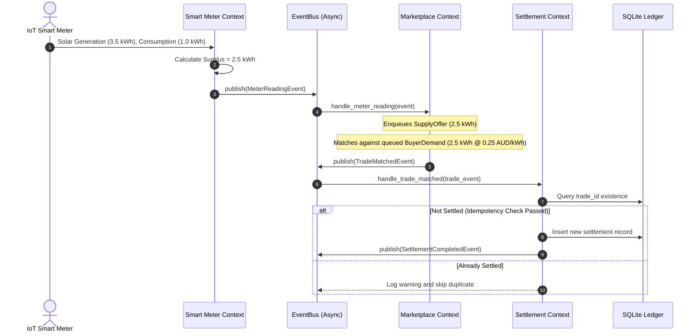

# EcoGrid Energy - Architecture Documentation

## 1. System Overview

EcoGrid Energy is an asynchronous, event-driven peer-to-peer (P2P) renewable energy trading platform designed to facilitate localized electricity transactions between residential prosumers (households equipped with solar PV systems) and energy consumers.

The architecture decouples high-frequency IoT smart meter telemetry ingestion from commercial trading logic and financial ledger persistence using Domain-Driven Design (DDD) bounded contexts and asynchronous event choreography.

---

## 2. Core Architecture Diagram

The diagram below illustrates the end-to-end event-driven pipeline:

---

## 3. Bounded Context Breakdown

### A. Smart Meter Integration Context (`smart_meter`)
- **Responsibility:** Ingests high-frequency electricity telemetry (generation and consumption in kWh) from IoT smart meters.
- **Key Logic:** Calculates net surplus solar energy (`surplus_kwh = max(generation - consumption, 0.0)`).
- **Event Contract Published:** `MeterReadingEvent` containing `meter_id`, `household_id`, `generation_kwh`, `consumption_kwh`, `timestamp`, and `correlation_id`.
- **Decoupling Guarantee:** Zero knowledge of order books, energy pricing, buyer identities, or database connections.

### B. Marketplace Context (`marketplace`)
- **Responsibility:** Coordinates peer-to-peer energy matching between local sellers and buyers.
- **Key Logic:**
  - Maintains in-memory FIFO supply and demand queues.
  - Executes price-compatible matching (`default_price <= maximum_price_per_kwh`).
  - Prevents overselling by atomically decrementing unallocated supply and demand.
  - Prevents self-trading (a household cannot buy from itself).
- **Event Contract Published:** `TradeMatchedEvent` containing `trade_id`, `seller_id`, `buyer_id`, `energy_kwh`, `price_per_kwh`, `timestamp`, and `correlation_id`.
- **Decoupling Guarantee:** Zero knowledge of smart meter hardware or database tables.

### C. Financial Settlement Context (`settlement`)
- **Responsibility:** Manages double-entry financial accounting and persistent ledger records.
- **Key Logic:**
  - Validates trade quantities and pricing.
  - Enforces strict idempotency checking via unique index on `trade_id`.
  - Persists records using parameterized SQL statements into `data/ecogrid.db`.
  - Calculates monetary total in AUD.
  - Publishes `SettlementCompletedEvent`.
- **Event Contract Published:** `SettlementCompletedEvent`.
- **Decoupling Guarantee:** Operates strictly on received trade events; has no knowledge of how trades were matched.

---

## 4. End-to-End Event Lifecycle

---

## 5. Comparison: Proof-of-Concept vs. Production Architecture

The table below contrasts the educational proof-of-concept with its production-grade cloud evolution:

| Architectural Dimension | Implemented Proof-of-Concept (PoC) | Proposed Production Target |
| :--- | :--- | :--- |
| **Messaging Infrastructure** | In-memory asynchronous `EventBus` with `asyncio` | Distributed partition broker (Apache Kafka / AWS Kinesis / Azure Service Bus) |
| **IoT Ingestion Gateway** | Simulated async batch generator (`SmartMeterSimulator`) | MQTT Gateway (AWS IoT Core / Azure IoT Hub) with TLS certificate authentication |
| **Context Deployment** | In-process modular packages | Independent containerized microservices managed via Kubernetes (EKS/GKE) |
| **Database Persistence** | Embedded ACID SQLite (`data/ecogrid.db`) | Clustered PostgreSQL (AWS Aurora / Cloud SQL) with read replicas |
| **Idempotency Control** | In-memory check + SQLite `UNIQUE` constraints | Redis distributed cache lock + Database constraint + Outbox Pattern |
| **Distributed Transactions** | Eventual consistency via event choreography | Orchestrated Saga pattern with Temporal.io / AWS Step Functions |
| **Observability & Tracing** | Python `logging` with structured correlation IDs | OpenTelemetry (OTel) traces + Prometheus metrics + Grafana dashboards |
| **Failure Recovery** | In-memory retry loop + Dead Letter Queue class | Dead Letter Queue (DLQ) topics with Kafka replay, alert paging (PagerDuty) |
