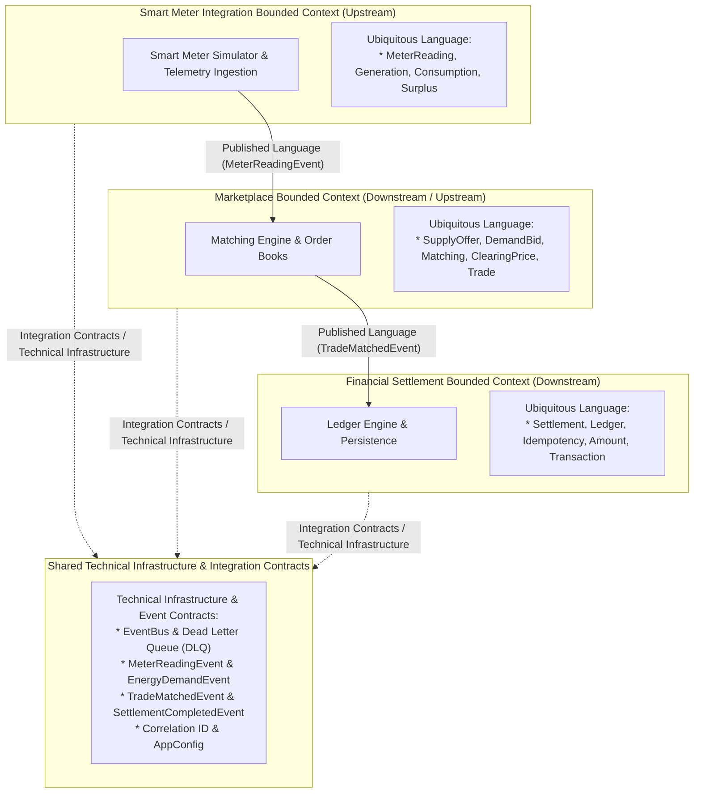

# EcoGrid Energy - Domain-Driven Design Context Map

## 1. Domain Context Map Overview

In Domain-Driven Design (DDD), a **Context Map** describes the strategic relationships, communication boundaries, and integration contracts between distinct **Bounded Contexts**.

EcoGrid Energy partitions the peer-to-peer renewable energy trading problem space into three explicit bounded contexts and a shared technical infrastructure and contracts layer:
1. **Smart Meter Integration Bounded Context**
2. **Marketplace Bounded Context**
3. **Financial Settlement Bounded Context**
4. **Shared Technical Infrastructure & Integration Contracts**

---

## 2. Context Map Diagram

---

## 3. Strategic Relationship Definitions

### 1. Smart Meter Integration $\rightarrow$ Marketplace
- **Relationship Type:** Upstream (U) / Downstream (D) with **Published Language (PL)**.
- **Upstream Context:** `Smart Meter Integration`
- **Downstream Context:** `Marketplace`
- **Integration Contract:** `MeterReadingEvent`
- **Integration Mechanism:** The Smart Meter Integration context publishes immutable `MeterReadingEvent` domain events. The Marketplace context subscribes to these events and translates the physical `surplus_kwh` into a marketplace `SupplyOffer`.
- **Decoupling Rationale:** The Smart Meter context operates as an autonomous producer. Changes to smart meter telemetry ingestion frequencies, sensor hardware, or device protocols do not impact marketplace matching rules.

### 2. Marketplace $\rightarrow$ Financial Settlement
- **Relationship Type:** Upstream (U) / Downstream (D) with **Published Language (PL)**.
- **Upstream Context:** `Marketplace`
- **Downstream Context:** `Financial Settlement`
- **Integration Contract:** `TradeMatchedEvent`
- **Integration Mechanism:** When buyer demand and seller supply are matched, the Marketplace context publishes a `TradeMatchedEvent`. The Financial Settlement context consumes this event and processes financial persistence and idempotency verification independently.
- **Decoupling Rationale:** The Marketplace operates without knowledge of settlement persistence engines, relational schemas, or ledger accounting rules. It guarantees only the economic integrity of matched trades.

### 3. Shared Technical Infrastructure & Integration Contracts
- **Role:** Rather than sharing a monolithic domain model, the bounded contexts remain strictly isolated and **use shared integration contracts** (`shared/models.py`) and **use shared technical infrastructure** (`shared/event_bus.py`, `shared/config.py`, `shared/logging_config.py`).
- **Core Elements:**
  - `EventBus` (Asynchronous in-memory dispatch engine)
  - `DeadLetterQueue` & `DeadLetterItem` (Fault containment)
  - Domain Event Contracts: `MeterReadingEvent`, `EnergyDemandEvent`, `TradeMatchedEvent`, `SettlementCompletedEvent`
  - Distributed Tracing: `correlation_id` propagation
  - Centralized Configuration: `AppConfig`

---

## 4. Ubiquitous Language Per Bounded Context

| Bounded Context | Ubiquitous Language Terms | Meaning & Domain Scope |
| :--- | :--- | :--- |
| **Smart Meter Integration** | `MeterReading`, `Generation`, `Consumption`, `Surplus` | Physical electricity measurements recorded by IoT hardware at the household solar/grid perimeter over time. |
| **Marketplace** | `SupplyOffer`, `DemandBid`, `Matching`, `ClearingPrice`, `Trade` | Commercial exchange mechanisms, order book priorities, bid-offer matching, and quota allocation. |
| **Financial Settlement** | `Settlement`, `Ledger`, `Idempotency`, `Amount`, `Transaction` | Monetary debit/credit records, transaction auditability, unique trade reconciliation, and double-entry consistency. |
| **Shared Technical Infrastructure** | `EventBus`, `DeadLetterQueue`, `CorrelationID`, `AppConfig` | Cross-cutting technical infrastructure enabling asynchronous messaging, fault tolerance, and observability across boundaries. |
